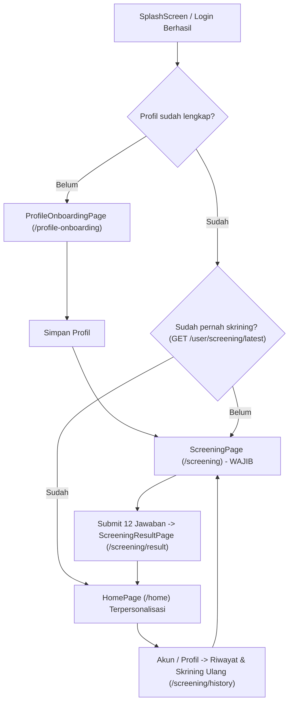
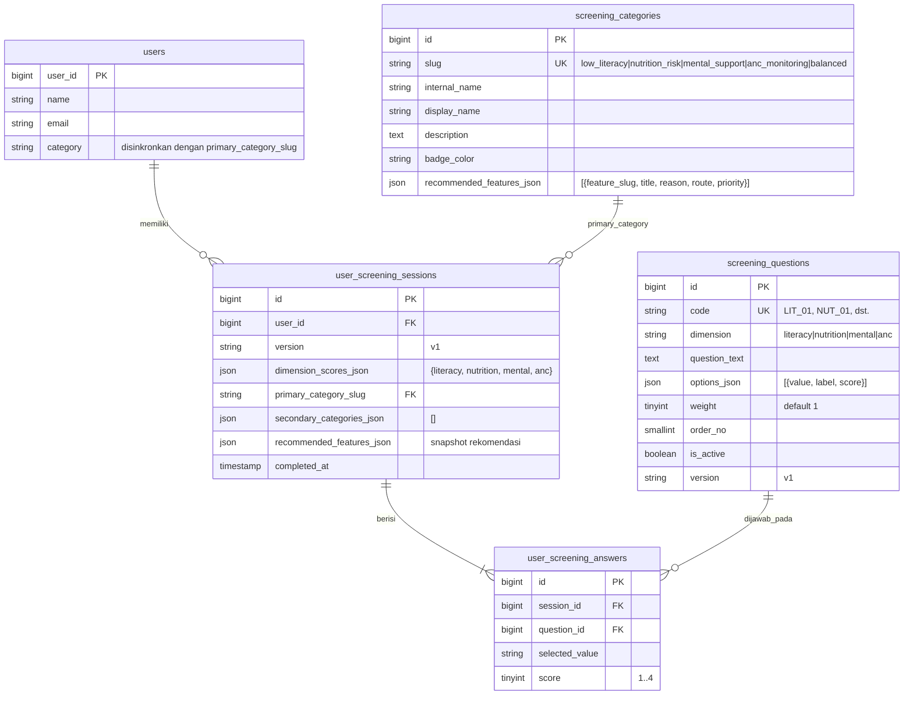

# Product Requirements Document (PRD)
## Fitur Skrining Awal & Personalisasi Rekomendasi Fitur — Prenava

| Informasi | Detail |
|---|---|
| **Nama Fitur** | Skrining Personalisasi & Rekomendasi Fitur Maternal |
| **Versi Dokumen** | 1.0 |
| **Tanggal** | 22 November 2026 |
| **Status** | Draft Acuan Implementasi |
| **Platform** | Backend (`prenava-backend-web` — Laravel) & Mobile (`prenava-mobile` — Flutter) |
| **Sifat Skrining** | **Wajib** (1 kali saat onboarding awal; dapat diulang kapan saja dari halaman Akun/Profil) |
| **Metode Penonjolan** | **Ganda**: Section *"Rekomendasi Khusus Bunda"* + Pengurutan Ulang & Badge di Grid Menu Home (+ sinkronisasi Misi Harian) |

---

## 1. Latar Belakang & Tujuan

### 1.1 Latar Belakang
Prenava memiliki banyak fitur kesehatan maternal (edukasi gizi, kearifan lokal/mitos kehamilan, prediksi anemia, prediksi depresi, risiko stunting & meal plan, hidrasi, olahraga, kalkulator HPL, komunitas, peta bidan, janji temu, hingga catatan kunjungan). Bagi ibu hamil baru, banyaknya menu di halaman beranda dapat menimbulkan kebingungan (*choice overload*), sehingga fitur yang sebenarnya paling dibutuhkan oleh kondisi ibu tersebut justru tidak diakses.

Di sisi lain, codebase Prenava saat ini telah memiliki fondasi awal berupa kolom `users.category`, mekanisme filter `daily_tasks.target_category` di `DailyFeatureController`, serta `featureTrackerProvider` untuk melacak fitur yang dibuka pengguna — namun belum memiliki instrumen skrining terstruktur untuk menentukan kategori pengguna secara objektif dan menonjolkan fitur terkait secara dinamis di beranda.

### 1.2 Tujuan Produk
1. **Mengklasifikasikan kebutuhan pengguna** ke dalam **5 kategori profil kebutuhan maternal** melalui skrining singkat (< 2 menit).
2. **Mengarahkan dan menonjolkan fitur Prenava paling relevan** kepada setiap pengguna tanpa menyembunyikan fitur lainnya.
3. **Menyelaraskan Misi Harian (`DailyTasks`)** dengan kategori hasil skrining untuk meningkatkan keterlibatan rutin pengguna.
4. **Menyediakan data historis & analitik** (skor per dimensi, kategori, dan keterkaitan dengan fitur yang benar-benar diakses) untuk evaluasi produk maupun kebutuhan riset.

### 1.3 Indikator Keberhasilan (KPI)
- **Screening Completion Rate**: ≥ 90% pengguna baru menyelesaikan skrining setelah `ProfileOnboardingPage`.
- **Recommendation Adoption Rate (CTR)**: ≥ 60% pengguna membuka minimal 1 fitur yang direkomendasikan dalam 7 hari pertama pasca-skrining.
- **Category-Feature Alignment**: Frekuensi akses fitur yang direkomendasikan meningkat signifikan dibanding sebelum personalisasi (diukur via `GET /api/user/feature-analytics`).

---

## 2. Ruang Lingkup

### 2.1 In-Scope
- Instrumen kuesioner skrining wajib (12 pertanyaan, 4 dimensi) yang dikelola dari backend (*server-driven*).
- Mesin skoring berbasis aturan (*rule-based weighted scoring*) di backend untuk menentukan 1 kategori utama (dari 5 kategori) + kategori sekunder (jika ada) + daftar 4 fitur rekomendasi beserta alasan.
- Sinkronisasi otomatis `primary_category_slug` ke kolom `users.category`.
- Penegakan alur **wajib skrining** pada `SplashScreen`, setelah login, dan setelah `ProfileOnboardingPage`.
- Halaman Skrining (`/screening`), Halaman Hasil Skrining (`/screening/result`), dan Riwayat/Skrining Ulang (`/screening/history`).
- Penonjolan ganda di `HomePage`:
  1. Section baru **"Rekomendasi Khusus Bunda"** (kartu rekomendasi + alasan + tombol langsung buka fitur).
  2. **Dynamic Menu Grid** (`_buildMenuGrid`) yang memindahkan fitur prioritas ke baris teratas dan menambahkan badge **"Disarankan"**.
- Penambahan seed `daily_tasks` per kategori di `DailyTaskSeeder` agar tab *Misi Harian* selaras dengan kategori.
- Perluasan endpoint `GET /api/user/feature-analytics` untuk mendukung segmentasi berdasarkan `category`.

### 2.2 Out-of-Scope (Fase Berikutnya)
- Diagnosis klinis medis otomatis (skrining ini murni untuk **personalisasi fitur & edukasi**, bukan alat diagnosis medis).
- Rekomendasi berbasis *Machine Learning / Collaborative Filtering* (fase 1 menggunakan *rule-based scoring* yang transparan dan mudah diaudit).
- Panel CMS web admin untuk CRUD pertanyaan skrining (pada fase 1 pertanyaan & kategori dikelola via migration + seeder).

---

## 3. Definisi 5 Kategori Pengguna & Pemetaan Fitur

> **Prinsip Etika & Copywriting (Non-Stigmatizing):**
> Label klinis/riset (seperti `low_literacy` atau *"Literasi Kesehatan Maternal Rendah"*) **hanya digunakan di database, API slug, dan analitik**. Di tampilan aplikasi (UI) yang dibaca langsung oleh ibu hamil, gunakan **Label Ramah** yang suportif dan membangun.

| No | Slug Internal (`users.category`) | Definisi Kategori (Internal / Riset) | Label Ramah di UI | 4 Fitur Utama yang Ditonjolkan (Urutan Prioritas) | Route Flutter & `AppFeature` Slug |
|---|---|---|---|---|---|
| 1 | `low_literacy` | **Literasi Kesehatan Maternal Rendah** — butuh penguatan pemahaman dasar kehamilan, tanda bahaya, gizi dasar, dan pelurusan mitos | **Panduan Dasar Kehamilan** | 1. Tips & Gizi<br>2. Kearifan Lokal (Mitos vs Fakta)<br>3. Kalkulator HPL<br>4. Komunitas Bunda | 1. `/tips` (`tips`)<br>2. Bottom Sheet Tab Kearifan Lokal (`local_wisdom`)<br>3. `/pregnancy-calculator` (`kalkulator_hpl`)<br>4. Tab Komunitas (`komunitas`) |
| 2 | `nutrition_risk` | **Risiko Gizi, Anemia & Stunting** — indikasi asupan nutrisi/cairan kurang optimal, gejala anemia, atau butuh panduan pencegahan stunting | **Fokus Gizi & Pencegahan Risiko** | 1. Prediksi Anemia<br>2. Risiko Stunting & Meal Plan<br>3. Rekomendasi Hidrasi<br>4. Rekomendasi Olahraga | 1. `/deteksi-anemia` (`anemia`)<br>2. `/stunting/history` (`stunting`)<br>3. `/hydration` (`hidrasi`)<br>4. `/rekomendasi-olahraga` (`olahraga`) |
| 3 | `mental_support` | **Kebutuhan Dukungan Kesehatan Mental** — mengalami kecemasan, kelelahan emosional, stres kehamilan, atau dukungan sosial rendah | **Fokus Ketenangan & Kesehatan Mental** | 1. Prediksi Depresi<br>2. Komunitas Bunda<br>3. Rekomendasi Olahraga<br>4. Tips & Gizi | 1. `/deteksi-depresi` (`depresi`)<br>2. Tab Komunitas (`komunitas`)<br>3. `/rekomendasi-olahraga` (`olahraga`)<br>4. `/tips` (`tips`) |
| 4 | `anc_monitoring` | **Kebutuhan Pendampingan Kontrol & Akses Bidan** — pemeriksaan ANC belum rutin, belum tahu lokasi bidan terdekat, atau belum teratur mencatat kunjungan | **Fokus Kontrol Rutin & Bidan** | 1. Janji Temu Bidan<br>2. Catatan Kunjungan<br>3. Peta Bidan Terdekat<br>4. Kalkulator HPL | 1. `/appointments` (`appointment`)<br>2. `/kunjungan` (`kunjungan`)<br>3. `/bidan-map` (`bidan_map` *(baru)*)<br>4. `/pregnancy-calculator` (`kalkulator_hpl`) |
| 5 | `balanced` | **Kondisi & Literasi Seimbang / Mandiri** — seluruh dimensi berada pada tingkat kesiapan baik (`>= 60`), fokus menjaga kebiasaan preventif | **Pemantauan Kehamilan Optimal** | 1. Kalkulator HPL<br>2. Rekomendasi Hidrasi<br>3. Rekomendasi Olahraga<br>4. Risiko Stunting & Meal Plan | 1. `/pregnancy-calculator` (`kalkulator_hpl`)<br>2. `/hydration` (`hidrasi`)<br>3. `/rekomendasi-olahraga` (`olahraga`)<br>4. `/stunting/history` (`stunting`) |

> **Catatan Teknis `AppFeature`:** Tambahkan `bidanMap` (`bidan_map`) ke enum `AppFeature` di `feature_tracker_provider.dart` dan `DailyTaskSeeder` agar semua fitur di kategori `anc_monitoring` terlacak konsisten.

---

## 4. Instrumen Pertanyaan Skrining (12 Pertanyaan, 4 Dimensi)

Setiap dimensi memiliki **3 pertanyaan** dengan **4 pilihan jawaban** bernilai **Skor Kesiapan (`1` s.d. `4`)**:
- **Skor `1`**: Sangat butuh pendampingan / sangat rendah
- **Skor `2`**: Masih perlu peningkatan / rendah
- **Skor `3`**: Cukup baik
- **Skor `4`**: Sangat baik / mandiri

### Dimensi 1: Literasi Kesehatan Maternal (`literacy`)
1. **`LIT_01`** — *"Seberapa paham Bunda mengenai tanda-tanda bahaya kehamilan yang harus segera diperiksakan (seperti perdarahan, bengkak parah, nyeri kepala hebat, atau gerak janin berkurang)?"*
   - Belum tahu sama sekali (`1`)
   - Pernah dengar sedikit, tapi belum yakin (`2`)
   - Cukup paham sebagian besar tanda bahaya (`3`)
   - Sangat paham dan tahu kapan harus segera ke tenaga kesehatan (`4`)
2. **`LIT_02`** — *"Ketika mendengar pantangan atau mitos kehamilan dari lingkungan sekitar/media sosial, bagaimana biasanya Bunda menyikapinya?"*
   - Langsung mengikuti karena takut terjadi apa-apa (`1`)
   - Sering bingung membedakan mana mitos dan mana fakta medis (`2`)
   - Biasanya mencari informasi tambahan dulu sebelum mengikuti (`3`)
   - Selalu memverifikasi ke tenaga kesehatan atau sumber medis terpercaya (`4`)
3. **`LIT_03`** — *"Seberapa paham Bunda tentang kebutuhan gizi harian dan perkembangan janin sesuai usia kehamilan saat ini?"*
   - Belum memahami kebutuhan gizi dan tahap perkembangan janin (`1`)
   - Baru tahu sedikit secara umum (`2`)
   - Cukup paham kebutuhan gizi utama per trimester (`3`)
   - Sangat paham dan sudah menerapkannya sehari-hari (`4`)

### Dimensi 2: Risiko Gizi, Anemia & Stunting (`nutrition`)
4. **`NUT_01`** — *"Dalam seminggu terakhir, bagaimana pola makan bergizi seimbang (protein, sayur, buah) dan kecukupan minum air putih (minimal 8 gelas/hari) Bunda?"*
   - Sangat jarang terpenuhi / makan dan minum sering tidak teratur (`1`)
   - Kadang-kadang saja terpenuhi (`2`)
   - Cukup sering terpenuhi di sebagian besar hari (`3`)
   - Rutin terpenuhi hampir setiap hari (`4`)
5. **`NUT_02`** — *"Apakah Bunda sering merasakan keluhan seperti mudah pusing, cepat lelah, lemas, pucat, atau belum rutin mengonsumsi Tablet Tambah Darah (TTD)?"*
   - Sangat sering mengalami keluhan tersebut dan tidak rutin minum TTD (`1`)
   - Cukup sering mengalami keluhan atau sering lupa minum TTD (`2`)
   - Jarang mengalami keluhan dan cukup rutin minum TTD (`3`)
   - Tidak ada keluhan dan rutin mengonsumsi TTD sesuai anjuran (`4`)
6. **`NUT_03`** — *"Seberapa rutin Bunda memantau asupan nutrisi pencegah stunting dan melakukan aktivitas fisik ringan yang aman untuk kehamilan?"*
   - Belum pernah memantau nutrisi khusus maupun berolahraga ringan (`1`)
   - Baru sesekali saja melakukannya (`2`)
   - Cukup rutin, meski belum terjadwal dengan rapi (`3`)
   - Sudah rutin dan terencana setiap minggu (`4`)

### Dimensi 3: Kesejahteraan Mental & Dukungan Emosional (`mental`)
7. **`MEN_01`** — *"Dalam 2 minggu terakhir, seberapa sering Bunda merasa sangat cemas, sedih berkepanjangan, atau mudah kewalahan menghadapi kehamilan?"*
   - Hampir setiap hari (`1`)
   - Beberapa hari dalam seminggu (`2`)
   - Jarang, hanya sesekali saja (`3`)
   - Hampir tidak pernah, perasaan cenderung stabil dan tenang (`4`)
8. **`MEN_02`** — *"Bagaimana kualitas tidur dan tingkat stres Bunda saat memikirkan kondisi kehamilan atau persiapan persalinan?"*
   - Tidur sangat terganggu dan sering merasa tertekan/stres berat (`1`)
   - Cukup sering susah tidur atau gelisah (`2`)
   - Tidur cukup baik, sesekali saja merasa khawatir wajar (`3`)
   - Tidur nyenyak dan merasa siap menghadapi kehamilan/persalinan (`4`)
9. **`MEN_03`** — *"Seberapa cukup dukungan emosional atau tempat bercerita yang Bunda rasakan dari pasangan, keluarga, atau sesama ibu hamil?"*
   - Merasa sendirian dan sangat jarang punya tempat bercerita (`1`)
   - Dukungan ada tapi masih terasa kurang (`2`)
   - Cukup mendapat dukungan dari orang terdekat (`3`)
   - Sangat didukung dan nyaman berbagi cerita kapan pun dibutuhkan (`4`)

### Dimensi 4: Kepatuhan Pemeriksaan & Akses Layanan Bidan (`anc`)
10. **`ANC_01`** — *"Seberapa teratur Bunda melakukan pemeriksaan kehamilan (ANC) ke bidan, puskesmas, atau dokter kandungan?"*
    - Belum pernah periksa atau sangat jarang periksa (`1`)
    - Hanya periksa jika sedang ada keluhan saja (`2`)
    - Cukup teratur, meski kadang terlewat dari jadwal (`3`)
    - Selalu rutin periksa sesuai jadwal anjuran tenaga kesehatan (`4`)
11. **`ANC_02`** — *"Seberapa mudah Bunda menemukan lokasi bidan/faskes terdekat dan mengatur jadwal konsultasi saat dibutuhkan?"*
    - Sangat kesulitan mencari bidan atau mengatur jadwal (`1`)
    - Agak kesulitan dan sering bingung harus menghubungi siapa (`2`)
    - Cukup mudah menemukan bidan/faskes di sekitar (`3`)
    - Sangat mudah dan sudah memiliki bidan/faskes langganan tetap (`4`)
12. **`ANC_03`** — *"Apakah Bunda terbiasa mencatat hasil pemeriksaan kehamilan dan memantau usia kehamilan serta Hari Perkiraan Lahir (HPL)?"*
    - Belum pernah mencatat dan belum tahu pasti usia kehamilan/HPL (`1`)
    - Jarang mencatat, hanya mengingat secara kasar (`2`)
    - Cukup sering mencatat di buku KIA atau ponsel (`3`)
    - Selalu mencatat rutin dan memantau perkembangan HPL secara berkala (`4`)

---

## 5. Algoritma Skoring & Aturan Klasifikasi

### 5.1 Perhitungan Skor per Dimensi
Setiap dimensi $d \in \{\text{literacy}, \text{nutrition}, \text{mental}, \text{anc}\}$ memiliki 3 pertanyaan dengan rentang jumlah skor mentah $S_d \in [3, 12]$.

$$\text{readiness\_score}_d = \text{round}\left(\frac{S_d - 3}{9} \times 100\right) \in [0, 100]$$

### 5.2 Aturan Penentuan Kategori Utama (`primary_category_slug`)
1. Tetapkan ambang batas kebutuhan pendampingan: **`THRESHOLD = 60`**.
2. Ambil semua dimensi dengan $\text{readiness\_score}_d < 60$:
   - **Jika TIDAK ADA dimensi dengan skor `< 60`** → `primary_category_slug = 'balanced'`.
   - **Jika ADA 1 atau lebih dimensi dengan skor `< 60`** → pilih dimensi dengan `readiness_score` **terendah** sebagai kategori utama:
     - `literacy` → `low_literacy`
     - `nutrition` → `nutrition_risk`
     - `mental` → `mental_support`
     - `anc` → `anc_monitoring`
3. **Aturan Tie-Breaker Deterministik** (jika 2+ dimensi sama-sama `< 60` dan memiliki skor persis sama):
   Prioritas klinis tertinggi dipilih lebih dulu:
   `mental` > `nutrition` > `anc` > `literacy`
4. **Kategori Sekunder (`secondary_categories_json`)**:
   Semua dimensi lain yang juga memiliki `readiness_score < 60` disimpan berurut dari skor terendah.

### 5.3 Penyusunan Daftar Fitur Rekomendasi (`recommended_features_json`)
- Ambil 4 fitur default dari `screening_categories.recommended_features_json` milik `primary_category_slug`.
- **Aturan Personalisasi Lintas Dimensi (Multi-Need)**: Jika `secondary_categories_json` tidak kosong, ganti slot ke-4 dengan fitur #1 dari kategori sekunder pertama (selama tidak duplikat dengan slot 1–3), agar kebutuhan sekunder pengguna tetap terakomodasi di beranda.

### 5.4 Contoh Perhitungan
Misal Ibu A menjawab:
- `literacy`: Q1=1, Q2=2, Q3=1 → $S = 4$ → `readiness_score = round((4-3)/9 * 100) = 11`
- `nutrition`: Q4=2, Q5=2, Q6=3 → $S = 7$ → `readiness_score = round((7-3)/9 * 100) = 44`
- `mental`: Q7=3, Q8=3, Q9=4 → $S = 10$ → `readiness_score = 78`
- `anc`: Q10=3, Q11=3, Q12=3 → $S = 9$ → `readiness_score = 67`

**Hasil:**
- `primary_category_slug`: `low_literacy` (skor terendah = `11 < 60`)
- `secondary_categories`: `["nutrition_risk"]` (skor = `44 < 60`)
- `users.category` diperbarui menjadi `'low_literacy'`
- `recommended_features`:
  1. `tips` (Tips & Gizi) — *dari `low_literacy`*
  2. `local_wisdom` (Kearifan Lokal) — *dari `low_literacy`*
  3. `kalkulator_hpl` (Kalkulator HPL) — *dari `low_literacy`*
  4. `anemia` (Prediksi Anemia) — *disisipkan dari dimensi sekunder `nutrition_risk`*

---

## 6. Alur Pengguna (User Flow) — Skrining Wajib



### Aturan Penegakan Wajib Skrining
1. **Pengguna Baru**: Setelah klik *"Selesai"* pada [profile_onboarding_page.dart](file:///D:/prenava/prenava-mobile/lib/features/profile/presentation/pages/profile_onboarding_page.dart), pengguna langsung diarahkan ke `/screening` (bukan `/home`).
2. **Pengguna Lama (Sudah Punya Profil, Belum Pernah Skrining)**: Saat membuka aplikasi lewat [splash_screen.dart](file:///D:/prenava/prenava-mobile/lib/features/splash/presentation/pages/splash_screen.dart) atau selesai login, sistem mengecek `has_completed_screening`. Jika `false`, pengguna diarahkan ke `/screening`.
3. **Tombol Back / Lewati**: Pada mode **skrining wajib awal** (`isInitial = true`), tidak ada tombol *"Lewati"* dan tombol back sistem dicegah (`PopScope(canPop: false)`) agar profil personalisasi terbentuk. Pada mode **skrining ulang** (`isInitial = false`, dibuka dari Profil/Riwayat), pengguna bebas kembali/membatalkan kapan saja.
4. **Fallback Gangguan Jaringan**: Jika `GET /user/screening/latest` gagal karena jaringan/timeout saat splash, tampilkan state retry dengan tombol *"Coba Lagi"* (jangan biarkan layar macet).

---

## 7. Spesifikasi UI/UX Mobile (`prenava-mobile`)

### 7.1 Halaman Skrining (`/screening`)
- Mengikuti gaya visual [profile_onboarding_page.dart](file:///D:/prenava/prenava-mobile/lib/features/profile/presentation/pages/profile_onboarding_page.dart): warna aksen `#FA6978`, progress bar atas (`1/12` s.d. `12/12`), label nama dimensi kecil di atas pertanyaan, dan 4 pilihan kartu besar yang nyaman disentuh.
- **Layar Pembuka Singkat (Step 0)**: Menjelaskan tujuan (*"Bantu kami menyiapkan beranda yang paling sesuai dengan kebutuhan Bunda — hanya 2 menit!"*) + disclaimer ringan bahwa ini bukan diagnosis medis.
- Tombol **"Lanjut"** aktif otomatis setelah memilih opsi; tombol **"Selesai & Lihat Rekomendasi"** di pertanyaan ke-12 memanggil `POST /api/user/screening/submit`.

### 7.2 Halaman Hasil Skrining (`/screening/result`)
- Menampilkan:
  1. **Kartu Ringkasan Kategori** (ikon, *Label Ramah*, deskripsi singkat suportif).
  2. **Ringkasan 4 Dimensi** (progress bar kecil per dimensi: Literasi, Gizi & Fisik, Mental, Kontrol ANC — tanpa istilah negatif yang menakutkan).
  3. **Daftar 4 Fitur Rekomendasi** berupa kartu dengan alasan singkat (*"Mengapa disarankan?"*) dan tombol aksi langsung (*"Buka Sekarang"*).
  4. Tombol utama **"Lanjut ke Beranda"** (`context.go('/home')`).

### 7.3 Penonjolan Ganda di `HomePage` ([home_page.dart](file:///D:/prenava/prenava-mobile/lib/features/home/presentation/pages/home_page.dart))

#### A. Pengurutan Ulang & Badge di Menu Grid (`_buildMenuGrid`)
- Ubah `_buildMenuGrid` dari daftar hardcoded menjadi **catalog data-driven** (`HomeMenuCatalog`) yang memetakan setiap `feature_slug` ke ikon, label, route, dan `AppFeature`.
- **Baris 1 (Slot 1–4)**: Diisi otomatis oleh 4 fitur dari `recommended_features` (atau 3 + sisa teratas jika ada fitur yang berupa Tab seperti Komunitas). Setiap item di kelompok rekomendasi mendapat penanda halus: **badge pill kecil `"Utama"` / `"Untukmu"`** di sudut ikon + aksen border tipis `#FA6978`.
- **Baris 2 (Slot 5–7)**: Diisi fitur populer lain yang tidak termasuk top 4.
- **Slot 8**: Tetap tombol **"Lainnya"** yang membuka [lainnya_modal.dart](file:///D:/prenava/prenava-mobile/lib/features/home/presentation/widgets/lainnya_modal.dart) berisi semua fitur sisa (termasuk `Janji Temu`, `Peta Bidan`, `Catatan Kunjungan`, `Riwayat Kesehatan`, `Kearifan Lokal`) — sehingga **tidak ada satu pun fitur yang hilang/disembunyikan**.
- Setiap klik menu tetap memanggil `ref.read(featureTrackerProvider).track(feature)` untuk analitik.

#### B. Section Khusus "Rekomendasi Khusus Bunda"
- Ditempatkan tepat di antara `MenuGrid` dan `BannerCarousel` (atau tepat di bawah `BannerCarousel`, di atas *Postingan Populer*).
- Header menampilkan judul **"Rekomendasi Untuk Bunda"** + chip kecil nama kategori ramah + tautan *"Skrining Ulang"*.
- Berisi horizontal list (`ListView.builder`) berisi **3–4 kartu fitur prioritas**:
  - Ikon fitur + Nama fitur
  - 1–2 baris alasan personalisasi (dari API, mis. *"Pelajari mitos vs fakta kehamilan agar lebih tenang"*)
  - Tombol CTA ringan *"Mulai →"* yang langsung mengarahkan ke route/tab fitur terkait + melacak `featureTrackerProvider`.

#### C. Sinkronisasi Misi Harian (`DailyTasksSection`)
- Karena `users.category` otomatis diperbarui saat submit skrining, endpoint `GET /api/user/daily-progress` di [DailyFeatureController.php](file:///D:/prenava/prenava-backend-web/app/Http/Controllers/DailyFeatureController.php#L27-L36) otomatis menampilkan tugas yang memiliki `target_category = users.category`.
- Tambahkan tugas spesifik untuk masing-masing 5 kategori di [DailyTaskSeeder.php](file:///D:/prenava/prenava-backend-web/database/seeders/DailyTaskSeeder.php).

### 7.4 Riwayat & Skrining Ulang (`/screening/history`)
- Dapat diakses dari halaman **Akun Saya / Profil** (`account_page.dart` / `profile_page.dart`) serta tautan di section Rekomendasi Home.
- Menampilkan daftar sesi skrining terdahulu (tanggal, kategori, ringkasan skor 4 dimensi) + tombol **"Lakukan Skrining Ulang"**.

---

## 8. Arsitektur Teknis & Desain Database (`prenava-backend-web`)

### 8.1 Entity Relationship Diagram (ERD)



### 8.2 Komponen Backend Baru
- **Migrations**: 4 tabel baru (`screening_questions`, `screening_categories`, `user_screening_sessions`, `user_screening_answers`).
- **Models**: `ScreeningQuestion`, `ScreeningCategory`, `UserScreeningSession`, `UserScreeningAnswer`.
- **Service**: `App\Services\ScreeningScoringService` (memisahkan logika skoring & rekomender agar mudah di-unit test).
- **Controller**: `App\Http\Controllers\ScreeningController`.
- **Seeders**: `ScreeningQuestionSeeder` (12 pertanyaan v1), `ScreeningCategorySeeder` (5 kategori + pemetaan fitur), dan pembaruan `DailyTaskSeeder` (misi harian per kategori).

---

## 9. Kontrak API (REST Endpoints)

Seluruh endpoint berada di bawah prefix `/api/user` dengan middleware `auth:api` (JWT).

### 9.1 `GET /api/user/screening/questions`
Mengambil pertanyaan skrining aktif untuk dirender di mobile.
```json
{
  "version": "v1",
  "has_completed_screening": false,
  "total_questions": 12,
  "questions": [
    {
      "id": 1,
      "code": "LIT_01",
      "dimension": "literacy",
      "dimension_label": "Pemahaman Kehamilan",
      "question_text": "Seberapa paham Bunda mengenai tanda-tanda bahaya kehamilan...",
      "order_no": 1,
      "options": [
        { "value": "1", "label": "Belum tahu sama sekali" },
        { "value": "2", "label": "Pernah dengar sedikit, tapi belum yakin" },
        { "value": "3", "label": "Cukup paham sebagian besar tanda bahaya" },
        { "value": "4", "label": "Sangat paham dan tahu kapan harus segera ke tenaga kesehatan" }
      ]
    }
  ]
}
```
*(Catatan: nilai `score` tidak perlu dikirim ke client agar tidak memengaruhi kejujuran jawaban pengguna.)*

### 9.2 `POST /api/user/screening/submit`
**Request:**
```json
{
  "version": "v1",
  "answers": [
    { "question_id": 1, "selected_value": "1" },
    { "question_id": 2, "selected_value": "2" }
  ]
}
```
**Validasi:** Semua pertanyaan aktif wajib terjawab (12 item), setiap `question_id` valid, dan `selected_value` termasuk dalam `options_json` pertanyaan terkait.

**Response (`201 Created`):**
```json
{
  "message": "Skrining berhasil disimpan",
  "session_id": 42,
  "completed_at": "2026-11-22T15:30:00+07:00",
  "dimension_scores": {
    "literacy": 11,
    "nutrition": 44,
    "mental": 78,
    "anc": 67
  },
  "primary_category": {
    "slug": "low_literacy",
    "display_name": "Panduan Dasar Kehamilan",
    "description": "Kami menyiapkan panduan praktis seputar tanda bahaya, gizi dasar, dan fakta kehamilan untuk mendampingi Bunda setiap hari.",
    "badge_color": "#FA6978"
  },
  "secondary_categories": ["nutrition_risk"],
  "recommended_features": [
    {
      "feature_slug": "tips",
      "title": "Tips & Gizi",
      "reason": "Pelajari tanda bahaya dan panduan dasar kehamilan secara ringkas.",
      "route": "/tips",
      "priority": 1
    },
    {
      "feature_slug": "local_wisdom",
      "title": "Kearifan Lokal",
      "reason": "Kenali mitos vs fakta medis seputar kehamilan.",
      "route": "action:local_wisdom",
      "priority": 2
    },
    {
      "feature_slug": "kalkulator_hpl",
      "title": "Kalkulator HPL",
      "reason": "Pantau perkembangan janin sesuai usia kehamilan Bunda.",
      "route": "/pregnancy-calculator",
      "priority": 3
    },
    {
      "feature_slug": "anemia",
      "title": "Prediksi Anemia",
      "reason": "Cek dini risiko anemia untuk menjaga energi dan kesehatan janin.",
      "route": "/deteksi-anemia",
      "priority": 4
    }
  ]
}
```

### 9.3 `GET /api/user/screening/latest`
Mengembalikan `{ "has_completed_screening": true, ... }` (format sama dengan payload `submit`) atau `{ "has_completed_screening": false }` jika belum pernah skrining.

### 9.4 `GET /api/user/screening/history`
Mengembalikan daftar ringkas sesi skrining user terbaru ke terlama (`session_id`, `completed_at`, `primary_category`, `dimension_scores`).

### 9.5 Perluasan `GET /api/user/feature-analytics?days=30&category=low_literacy`
Menambahkan query parameter opsional `category` (filter `users.category`) serta pengelompokan hasil per kategori pengguna agar efektivitas penonjolan fitur dapat dievaluasi langsung.

---

## 10. Non-Functional Requirements & Keamanan

- **Disclaimer Medis**: Halaman skrining dan hasil wajib mencantumkan catatan singkat bahwa hasil skrining bertujuan untuk personalisasi fitur aplikasi dan tidak menggantikan konsultasi tenaga kesehatan.
- **Integritas Data**: Proses penyimpanan `user_screening_sessions`, `user_screening_answers`, dan update `users.category` dibungkus dalam `DB::transaction()`.
- **Performa**: `GET /api/user/screening/latest` di-cache di state Riverpod (`screeningLatestProvider`) dan di-invalidate hanya saat user melakukan skrining ulang atau logout.
- **Backward Compatibility**: Jika suatu saat ada `feature_slug` baru dari backend yang belum dikenal versi aplikasi lama, mobile mengabaikan slug tak dikenal tersebut secara aman (*graceful fallback* ke urutan default) tanpa crash.

---

## 11. Kriteria Penerimaan (Acceptance Criteria)

1. Pengguna baru setelah menyelesaikan `ProfileOnboardingPage` **wajib** masuk ke `/screening` dan tidak bisa melompat langsung ke `/home`.
2. Pengguna lama yang sudah memiliki profil tetapi belum pernah mengisi skrining otomatis diarahkan ke `/screening` saat membuka aplikasi.
3. Submit 12 jawaban menghasilkan skor 4 dimensi akurat sesuai rumus, menetapkan 1 dari 5 kategori dengan benar (termasuk aturan tie-breaker dan kategori sekunder), serta memperbarui `users.category`.
4. Halaman hasil menampilkan label ramah (non-stigma) dan 4 kartu fitur yang semuanya bisa diklik menuju halaman/tab terkait.
5. `HomePage` menampilkan **Section "Rekomendasi Khusus Bunda"** DAN **urutan grid menu yang berubah sesuai kategori** lengkap dengan badge `"Disarankan"` pada fitur prioritas, sementara fitur lainnya tetap tersedia di baris kedua / modal *Lainnya*.
6. Tab *Misi Harian* menampilkan tugas harian yang selaras dengan `users.category`.
7. Pengguna dapat melihat riwayat dan melakukan **Skrining Ulang** dari menu Profil/Akun, dan perubahan kategori langsung memperbarui tampilan `HomePage`.
8. Klik fitur dari section Rekomendasi maupun Grid Menu tercatat di `POST /api/user/feature-track` dan muncul pada `GET /api/user/feature-analytics`.

---

## 12. Rencana Implementasi Bertahap

1. **Fase 1 — Backend Core (`prenava-backend-web`)**
   - Buat 4 migration, 4 model, `ScreeningQuestionSeeder`, `ScreeningCategorySeeder`, dan pembaruan `DailyTaskSeeder`.
   - Implementasi `ScreeningScoringService` + unit test (uji semua 5 kategori, batas skor `59` vs `60`, tie-breaker, dan penyisipan kategori sekunder).
   - Implementasi `ScreeningController` + daftarkan route di `routes/api.php` + perluas `featureAnalytics`.
2. **Fase 2 — Mobile Screening Flow (`prenava-mobile`)**
   - Buat modul baru `lib/features/screening/` (data models, remote datasource, repository, Riverpod providers).
   - Buat UI `ScreeningPage`, `ScreeningResultPage`, dan `ScreeningHistoryPage`, lalu daftarkan di `app_router.dart`.
   - Pasang guard wajib skrining di `SplashScreen`, alur login, dan redirect akhir `ProfileOnboardingPage`.
3. **Fase 3 — Personalisasi Home & Misi Harian (`prenava-mobile`)**
   - Refactor `_buildMenuGrid` di `home_page.dart` menjadi *data-driven* dengan *dynamic reordering* + badge *"Disarankan"*.
   - Buat widget `RecommendedFeaturesSection` ("Rekomendasi Khusus Bunda") di `home_page.dart`.
   - Tambah `AppFeature.bidanMap` dan pastikan semua klik fitur ter-track.
   - Tambah menu *"Riwayat & Skrining Ulang"* di halaman Akun/Profil.
4. **Fase 4 — Verifikasi End-to-End**
   - Jalankan migrasi & seeder di Docker backend.
   - Uji seluruh 5 skenario kategori dari skrining → hasil → tampilan Home → klik fitur → verifikasi `feature-analytics`.
